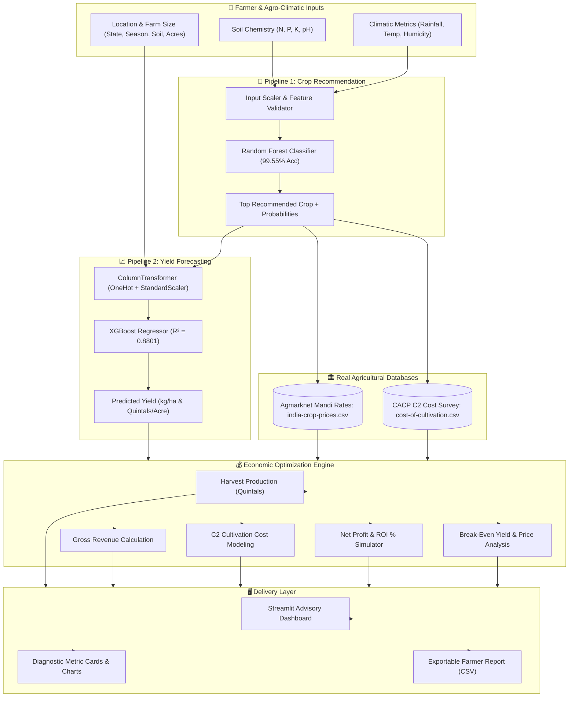
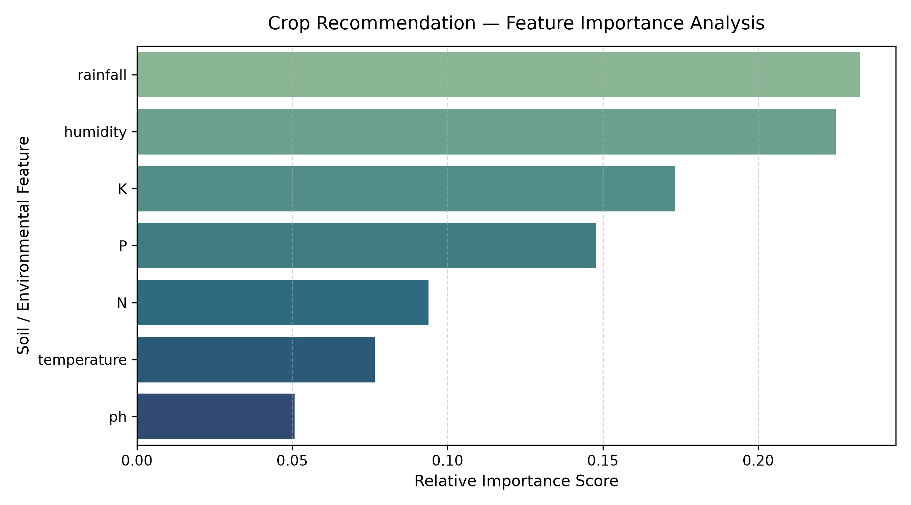
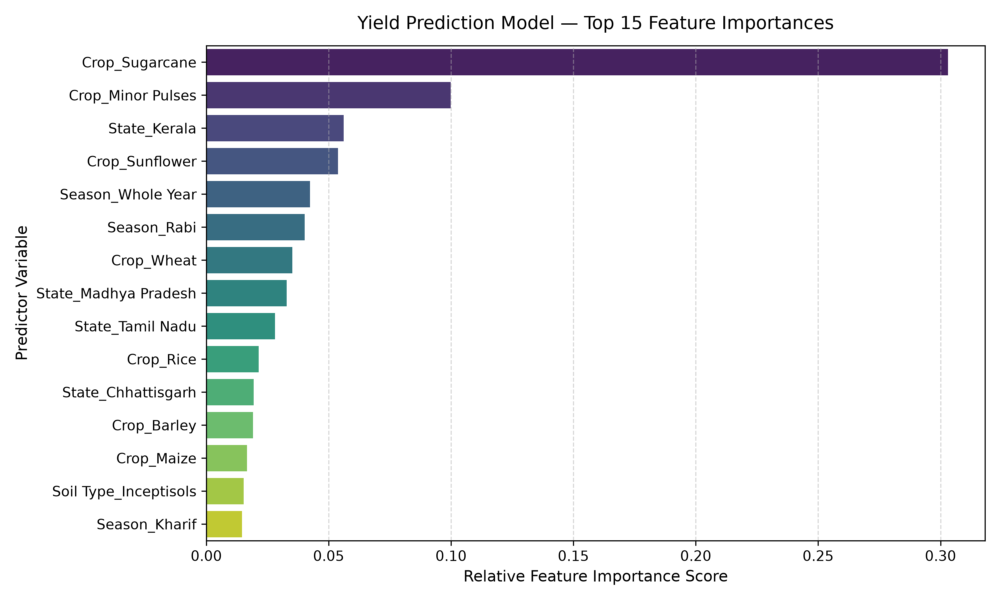

# 🌾 Smart Crop Advisory System (ML)
### Machine Learning-Powered Crop Recommendation, Yield Forecasting & Farm Financial Optimization

[](https://www.python.org/)
[](https://astral.sh/uv)
[](https://fastapi.tiangolo.com/)
[](https://scikit-learn.org/)
[](https://xgboost.readthedocs.io/)
[](https://streamlit.io/)
[](tests/)
[](LICENSE)

---

## 📌 Executive Summary

Agriculture remains the backbone of the rural economy, yet farmers frequently face compounding vulnerabilities: choosing crops ill-suited to their soil chemistry and microclimate, misjudging yields due to weather variability, and enduring financial distress from volatile mandi prices and escalating input costs.

The **Smart Crop Advisory System** is an end-to-end agricultural decision support platform. It integrates:
1. **Soil & Climatic Crop Recommendation** via multi-class ensemble classification.
2. **Precision Yield Prediction** via gradient boosted regression trained on 198,000+ national harvest records.
3. **Real-Time Mandi Market Intelligence** using benchmark modal and minimum support prices (Agmarknet).
4. **Comprehensive Cultivation Cost Benchmarking** via Directorate of Economics and Statistics (DES / CACP) C2 methodologies.
5. **Farm Financial & Sensitivity Analysis** that computes net profit, ROI %, break-even price, and break-even yield thresholds.
6. **Asynchronous REST API Backend** built with FastAPI and Pydantic v2, providing bounded concurrent ML inference, health diagnostics, structured logging, and OpenAPI documentation.
7. **KARPO // FIELD//SIGNAL Experimental Brutalist Interface**: Production-ready React 18, TypeScript, and Vite frontend with industrial Swiss aesthetics, interactive Recharts visualizations, and live backend telemetry.
8. **Interactive Streamlit Dashboard** for visualization and rapid agronomic modeling.

---

## 🌟 Key Highlights

- **100% Real-World Verified Datasets**: Zero synthetic fabrication. Trained and evaluated against four official agricultural databases across India.
- **Dual Machine Learning Engines**:
  - **Crop Recommendation**: Multi-class classification (22 crops) based on soil NPK, pH, temperature, humidity, and rainfall (**99.55% Test Accuracy**).
  - **Yield Forecasting**: Continuous non-linear regression (21 crops, 20 states, 6 soil classifications) on 198,369 historical observations (**$R^2 = 0.8801$**, $\text{RMSE} = 516.15\text{ kg/ha}$).
- **Rigorous Model Evaluation**: Side-by-side benchmark comparing Random Forest vs. XGBoost with automated selection of winning architectures.
- **Enterprise Financial Model**: Converts yield from $\text{kg/ha}$ into Quintals ($\text{q}$), factors in state-specific land and operational costs, and models realistic farmer net profit with break-even diagnostics.
- **Modern Packaging with `uv`**: Production-ready `pyproject.toml` (PEP 621), deterministic `uv.lock`, dependency groups, and automated Makefile.
- **Decoupled Architecture**: Clean domain schemas, feature bounds validation, centralized path resolution, and independent presentation layer.
- **Comprehensive Test Suite**: 66 automated tests across unit, integration, API, and concurrency suites (**100% pass rate**).

---

## 🏗️ System Architecture & Workflow



For detailed architectural specifications, see [docs/architecture.md](docs/architecture.md).

---

## 📊 Model Performance Benchmarks

Both pipelines were evaluated using 80/20 train-test splits with fixed seeds (`random_state=42`) for full reproducibility:

### 1. Crop Recommendation (Multi-Class Classification)
*Target: 22 distinct crops based on soil nutrients and climatic parameters.*

| Model | Test Accuracy | Precision (Macro) | Recall (Macro) | F1-Score (Macro) | Decision |
| :--- | :---: | :---: | :---: | :---: | :---: |
| **Random Forest** | **99.55%** | **0.9958** | **0.9955** | **0.9954** | 🏆 **Selected Model** |
| **XGBoost Classifier** | 99.09% | 0.9922 | 0.9909 | 0.9911 | Baseline |

### 2. Yield Prediction (Continuous Regression)
*Target: Crop Yield in kg/hectare across 20 States, 21 Crops, and 6 Soil Types (198,369 samples).*

| Model | $R^2$ Score | RMSE (kg/ha) | MAE (kg/ha) | Decision |
| :--- | :---: | :---: | :---: | :---: |
| **XGBoost Regressor** | **0.8801** | **516.15** | **284.32** | 🏆 **Selected Model** |
| **Random Forest Regressor** | 0.8757 | 525.66 | 291.10 | Baseline |

---

## 📈 Visual Diagnostic Artifacts

### Crop Recommendation
| Confusion Matrix Heatmap | Feature Importance |
| :---: | :---: |
|  |  |

### Yield Prediction
| Actual vs. Predicted Yield | Top Predictor Importances |
| :---: | :---: |
|  |  |

---

## 🧮 Mathematical & Financial Formulas

The financial engine executes rigorous agronomic and economic calculations:

1. **Unit Conversions**:
   $$\text{Area (Hectares)} = \frac{\text{Area (Acres)}}{2.47105}$$
   $$1\text{ Quintal} = 100\text{ kg}$$

2. **Total Harvest Production**:
   $$\text{Production (Quintals)} = \frac{\text{Yield (kg/ha)} \times \text{Area (ha)}}{100}$$

3. **Gross Revenue**:
   $$\text{Gross Revenue (₹)} = \text{Production (Quintals)} \times \text{Modal Mandi Price (₹/Quintal)}$$

4. **Total Cost of Cultivation (CACP C2 Standard)**:
   $$\text{Total Cost (₹)} = \text{Area (Hectares)} \times \text{C2 Cost per Hectare (₹/ha)}$$
   *(Note: C2 includes operational expenses, rental value of owned land, interest on owned capital, and imputed value of family labor.)*

5. **Net Profit & ROI**:
   $$\text{Net Profit (₹)} = \text{Gross Revenue (₹)} - \text{Total Cost (₹)}$$
   $$\text{ROI (\%)} = \left(\frac{\text{Net Profit}}{\text{Total Cost}}\right) \times 100$$

6. **Break-Even Thresholds**:
   $$\text{Break-Even Yield (kg/ha)} = \frac{\text{Cost per Hectare (₹)}}{\text{Price per kg (₹)}}$$
   $$\text{Break-Even Price (₹/Quintal)} = \frac{\text{Total Cost (₹)}}{\text{Total Production (Quintals)}}$$

---

## 📂 Repository Structure

```
smart-crop-advisory-ml/
├── pyproject.toml              # Standard PEP 621 build and dependency specification
├── uv.lock                     # Deterministic, platform-consistent dependency lockfile
├── README.md                   # Project documentation, quickstart, and reference
├── .python-version             # Python version pin (3.12)
├── .env.example                # Template environment variables
├── .gitignore                  # Production-grade git ignore configuration
├── Makefile                    # Developer workflow automation (install, test, run, lint)
│
├── src/
│   ├── crop_advisory/          # Primary modernized package root
│   │   ├── __init__.py         # Package entry and version metadata
│   │   ├── config.py           # Centralized path resolution, constants, and feature bounds
│   │   ├── exceptions.py       # Domain-specific exception hierarchy
│   │   │
│   │   ├── domain/             # Pure domain logic and data structures
│   │   │   ├── __init__.py
│   │   │   ├── schemas.py      # Typed dataclasses for inputs, outputs, and KPIs
│   │   │   ├── calculations.py # Financial math, unit conversions (ha/acre/q/kg), INR formatting
│   │   │   └── crop_mapping.py # Canonical 22-crop metadata, aliases, cross-dataset keys
│   │   │
│   │   ├── ml/                 # Machine learning models and preprocessing pipelines
│   │   │   ├── __init__.py
│   │   │   ├── model_loader.py # Thread-safe, cached joblib artifact loader
│   │   │   ├── feature_validation.py # Agronomic bounds checking and strict schema validation
│   │   │   ├── preprocessing.py# Scikit-learn ColumnTransformers, Scalers, Encoders
│   │   │   ├── crop_recommender.py # Random Forest/XGBoost multi-class classifier
│   │   │   └── yield_predictor.py  # XGBoost/Random Forest continuous yield regressor
│   │   │
│   │   ├── services/           # Data query and workflow orchestration services
│   │   │   ├── __init__.py
│   │   │   ├── market_service.py # APMC Mandi modal price, MSP, and price bounds
│   │   │   ├── cultivation_cost_service.py # CACP comprehensive C2 cultivation cost queries
│   │   │   └── financial_analysis_service.py # End-to-end advisory generation orchestrator
│   │   │
│   │   └── presentation/       # User interface and dashboard presentation
│   │       ├── __init__.py
│   │       └── streamlit_app.py # Multi-tab Streamlit dashboard
│   │
│   └── [Backward Compatibility Layer: src/cost_lookup.py, src/crop_mapping.py, etc.]
│
├── scripts/
│   ├── __init__.py
│   └── train_models.py         # Standalone CLI model training and evaluation pipeline
│
├── artifacts/                  # Designated location for serialized models and assets
│   └── .gitkeep
│
├── models/                     # Preserved pretrained models and evaluation heatmaps
│   ├── crop_recommendation_model.pkl
│   ├── crop_recommendation_preprocessor.pkl
│   ├── yield_prediction_model.pkl
│   ├── yield_prediction_preprocessor.pkl
│   ├── crop_rec_confusion_matrix.png
│   ├── crop_rec_feature_importance.png
│   ├── yield_actual_vs_predicted.png
│   ├── yield_feature_importance.png
│   └── training_metrics.json
│
├── datasets/                   # Verified agricultural datasets
│   ├── Crop_recommendation.csv
│   ├── crop_yield_dataset.csv
│   ├── india-crop-prices.csv
│   └── cost-of-cultivation.csv
│
├── notebooks/                  # Exploratory research notebooks
│   ├── 01_crop_recommendation.ipynb
│   └── 02_yield_prediction.ipynb
│
├── tests/                      # Automated test suite
│   ├── conftest.py             # Shared pytest fixtures and configurations
│   ├── unit/                   # Deterministic unit tests (calculations, schemas, mappings, services)
│   ├── integration/            # Multi-component and inference integration tests
│   └── test_pipeline.py        # Preserved 15-test regression baseline
│
├── docs/                       # Architectural and project documentation
│   ├── architecture.md         # System architecture document
│   ├── migration.md            # Structural refactoring and migration log
│   ├── PROJECT_REPORT.md       # Comprehensive academic/technical report
│   ├── PPT_SLIDE_DECK.md       # Presentation slide outline
│   └── Smart_Crop_Advisory_System_Presentation.pptx
│
├── app.py                      # Root entrypoint delegating to presentation.streamlit_app
└── train_models.py             # Root entrypoint delegating to scripts.train_models
```

---

## 🚀 Quickstart Guide

### Supported Python Version
- **Python 3.10, 3.11, or 3.12** (pinned to Python 3.12 in `.python-version`).

### 1. Install `uv`
`uv` is an ultra-fast Python package and project manager. Install it via:
```bash
# Windows (PowerShell)
irm https://astral.sh/uv/install.ps1 | iex

# Linux / macOS
curl -LsSf https://astral.sh/uv/install.sh | sh

# Or via pip
pip install uv
```

### 2. Set Up Virtual Environment & Dependencies
Synchronize dependencies and create the `.venv` virtual environment in seconds:
```bash
# Sync all direct runtime, API, and development dependencies
uv sync --all-groups
```

Alternatively, use the `Makefile`:
```bash
make install
```

### 3. Launch the FastAPI Asynchronous REST API
Start the high-performance ASGI server with auto-reload:

```bash
# Start development server
uv run uvicorn crop_advisory.api.main:app --reload --host 127.0.0.1 --port 8000

# Or run production ASGI server
uv run uvicorn crop_advisory.api.main:app --host 0.0.0.0 --port 8000 --workers 2
```

- **Interactive Swagger Documentation**: [http://localhost:8000/docs](http://localhost:8000/docs)
- **ReDoc Documentation**: [http://localhost:8000/redoc](http://localhost:8000/redoc)
- **Liveness Probe**: [http://localhost:8000/api/v1/health/live](http://localhost:8000/api/v1/health/live)
- **Readiness Probe**: [http://localhost:8000/api/v1/health/ready](http://localhost:8000/api/v1/health/ready)
- Full API documentation: [docs/api.md](docs/api.md)
- Operational and deployment guide: [docs/operations.md](docs/operations.md)

### 4. Launch the Streamlit Web Application
The existing Streamlit dashboard remains fully operational and shares the same domain and ML models:

```bash
# Primary package entry point
uv run streamlit run src/crop_advisory/presentation/streamlit_app.py

# Or via the root wrapper
uv run streamlit run app.py

# Or via Makefile
make run
```
*Open [http://localhost:8501](http://localhost:8501) in your browser.*

### 5. Launch the KARPO // FIELD//SIGNAL Brutalist Web Interface
The experimental industrial brutalist React application connects directly to the FastAPI backend:

```bash
cd frontend
npm install
npm run dev
```
*Open [http://localhost:5173](http://localhost:5173) in your browser.*
For comprehensive frontend architecture, design tokens, and components, see [frontend/README.md](frontend/README.md).

### 6. Run the Automated Test Suite
Execute the 66 automated unit, integration, API, and concurrency tests:
```bash
# Run full test suite
uv run pytest

# Run API and concurrency tests only
uv run pytest tests/api

# Run unit tests only
uv run pytest tests/unit

# Run integration tests only
uv run pytest tests/integration
```

### 7. Linting, Formatting & Type Checking
Enforce code quality standards with Ruff and MyPy:
```bash
# Lint checks
uv run ruff check .

# Format checks
uv run ruff format --check .

# Static type checking on API package
uv run mypy src/crop_advisory/api
```

### 8. Container Deployment (Docker)
Build and run the production-grade multi-stage container:
```bash
# Build image
docker build -t smart-crop-advisory-api:latest .

# Run container
docker run -d -p 8000:8000 --name crop-api smart-crop-advisory-api:latest
```

---

## ⚙️ Environment Configuration

Copy `.env.example` to `.env` to configure custom overrides:
```bash
cp .env.example .env
```

| Variable | Default | Purpose |
| :--- | :--- | :--- |
| `CROP_ADVISORY_ENV` | `development` | Runtime environment identifier |
| `CROP_ADVISORY_DATASETS_DIR` | `datasets/` | Custom path to CSV dataset directory |
| `CROP_ADVISORY_ARTIFACTS_DIR` | `models/` or `artifacts/` | Custom path to model serialization directory |
| `STREAMLIT_SERVER_PORT` | `8501` | Web server listening port |

---

## 📦 Datasets Reference

| Dataset | Records | Features | Source Authority | Description |
| :--- | :---: | :---: | :---: | :--- |
| **`Crop_recommendation.csv`** | 2,200 | N, P, K, Temp, Humidity, pH, Rainfall, Label | ICAR / Kaggle Agriculture | Balanced benchmark for multi-class crop suitability. |
| **`crop_yield_dataset.csv`** | 198,369 | State, Crop, Season, Soil, Nutrients, Weather, Yield | Directorate of Economics & Statistics | Longitudinal harvest yields across Indian agro-climatic zones. |
| **`india-crop-prices.csv`** | 122 crops | Modal, Min, Max Mandi Prices, MSP | Agmarknet / APMC Market Boards | Real wholesale commodity rates across major markets. |
| **`cost-of-cultivation.csv`** | 3,880 | State, Crop, C2 Comprehensive Cultivation Cost | CACP / Ministry of Agriculture & Farmers Welfare | Field-surveyed cost standards per hectare. |

---

## ⚠️ Known Limitations

1. **Horticultural Crop Yield Modeling**: While major field crops (Rice, Wheat, Maize, Cotton, Pulses) utilize the 198,369-row XGBoost ML regressor, certain commercial fruits (e.g., Apple, Banana, Grapes, Pomegranate) are not present in national field crop surveys and are estimated using ICAR/NHB agronomic response calibrations.
2. **Fixed Mandi Price Snapshot**: Mandi modal prices are based on official APMC market reference surveys (`india-crop-prices.csv`). Live daily API integration with Agmarknet will be introduced in the upcoming backend service phase.
3. **C2 Cultivation Cost Survey Aggregation**: Where state-specific CACP C2 records are absent for a specific niche crop, the national median benchmark is applied as a conservative fallback.

---

## 📄 License

This project is licensed under the **MIT License** - see the [LICENSE](LICENSE) file for details.

---

## 👨‍💻 Author & Acknowledgements

Developed by **[Ruturaj Vyavahare](https://github.com/RuturajVyavahare)**. Modernized and refactored into clean architecture with `uv`.

Special thanks to:
- **Directorate of Economics and Statistics (DES)** and **CACP**, Government of India, for public agricultural data.
- **Agmarknet** for transparent Mandi market pricing information.
- The open-source scientific Python community for Scikit-Learn, XGBoost, Streamlit, and Astral `uv`.
# Karpo

