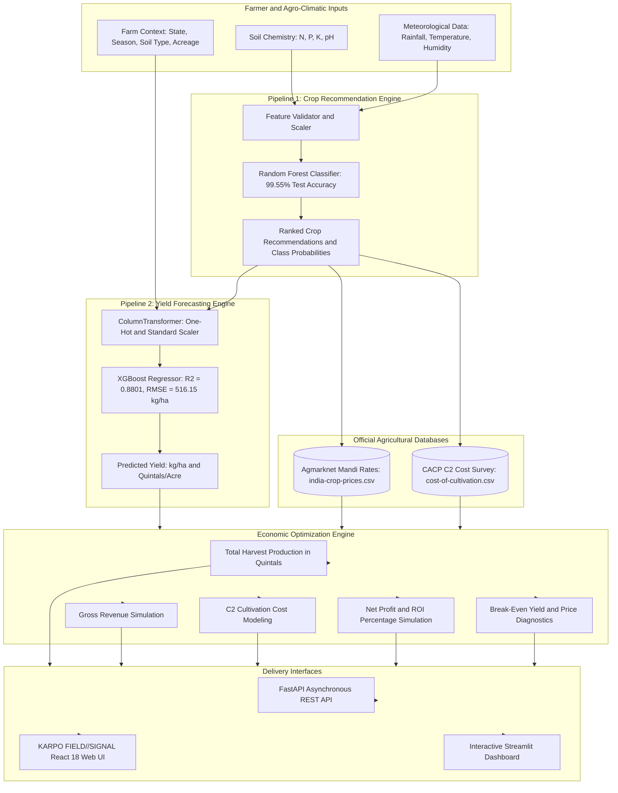

# Karpo: Smart Crop Advisory System (ML)
### Machine Learning-Driven Crop Recommendation, Yield Forecasting, and Farm Financial Optimization

[](https://www.python.org/)
[](https://astral.sh/uv)
[](https://fastapi.tiangolo.com/)
[](frontend/)
[](frontend/)
[](frontend/)
[](https://scikit-learn.org/)
[](https://xgboost.readthedocs.io/)
[](https://streamlit.io/)
[](tests/)
[](LICENSE)

---

## Executive Summary

Agriculture remains the cornerstone of the rural economy, yet agrarian stakeholders routinely face compounding risks: planting crops unaligned with regional soil chemistry and microclimates, misjudging yields due to seasonal variability, and suffering financial losses caused by mandi price volatility and escalating cultivation costs.

**Karpo** is an enterprise-grade agricultural decision support and intelligence platform named after the Greek deity of fruits and harvests. The system synthesizes predictive machine learning models, official government agricultural surveys, and financial simulation algorithms into unified advisory interfaces.

The platform provides:
1. **Soil and Climatic Crop Recommendation**: Multi-class ensemble classification identifying optimal crops based on nitrogen, phosphorus, potassium, pH, temperature, relative humidity, and rainfall.
2. **Precision Yield Prediction**: Gradient-boosted regression trained on 198,369 historical harvest records across 20 Indian states, 21 crops, and 6 soil classifications.
3. **Mandi Market Intelligence**: Real-world modal, minimum, maximum, and Minimum Support Prices (MSP) derived from Agmarknet wholesale surveys.
4. **Cultivation Cost Benchmarking**: Operational and fixed cost estimation using Directorate of Economics and Statistics (DES) and Commission for Agricultural Costs and Prices (CACP) Comprehensive C2 cost standards.
5. **Farm Financial and Sensitivity Simulation**: Automated computation of total production, gross revenue, net profit, return on investment (ROI %), break-even price, and break-even yield thresholds.
6. **Asynchronous REST API Backend**: High-throughput FastAPI service with Pydantic v2 schemas, bounded threadpool concurrency, liveness and readiness health probes, and OpenAPI documentation.
7. **KARPO FIELD//SIGNAL Modern Web Interface**: Production-grade React 18, TypeScript, and Vite single-page application built with an industrial data-dense aesthetic, interactive Recharts visualizations, and live backend telemetry.
8. **Interactive Streamlit Application**: Rapid agronomic exploratory dashboard supporting quick scenario modeling.
9. **Trilingual Localization**: First-class support for English, Hindi, and Marathi across both web and Streamlit interfaces.

---

## System Architecture



Detailed architectural specifications, data flows, and design patterns are documented in [docs/architecture.md](docs/architecture.md).

---

## Machine Learning Pipelines and Performance

All models were evaluated using an 80/20 train-test split with fixed pseudo-random seeds (`random_state=42`) for deterministic reproducibility.

### 1. Crop Recommendation (Multi-Class Classification)
- **Target**: 22 distinct crops based on soil macro-nutrients (N, P, K), pH, and micro-climatic parameters.
- **Dataset**: 2,200 verified agro-ecological observations.
- **Winning Architecture**: Random Forest Classifier (100 estimators).

| Model | Test Accuracy | Precision (Macro) | Recall (Macro) | F1-Score (Macro) | Selection Status |
| :--- | :---: | :---: | :---: | :---: | :---: |
| **Random Forest Classifier** | **99.55%** | **0.9958** | **0.9955** | **0.9954** | **Production Selected** |
| XGBoost Classifier | 99.09% | 0.9922 | 0.9909 | 0.9911 | Evaluated Baseline |

### 2. Yield Prediction (Continuous Regression)
- **Target**: Crop yield in kilograms per hectare (kg/ha).
- **Features**: State, Crop, Season, Soil Type, Area, Rainfall, Temperature, Humidity, Soil N, P, K, pH.
- **Dataset**: 198,369 longitudinal harvest records across 20 Indian states.
- **Winning Architecture**: XGBoost Regressor (n_estimators=300, max_depth=8, learning_rate=0.08, colsample_bytree=0.8).

| Model | R-Squared (R2) | RMSE (kg/ha) | MAE (kg/ha) | Selection Status |
| :--- | :---: | :---: | :---: | :---: |
| **XGBoost Regressor** | **0.8801** | **516.15** | **284.32** | **Production Selected** |
| Random Forest Regressor | 0.8757 | 525.66 | 291.10 | Evaluated Baseline |

Diagnostic evaluation heatmaps and feature importance plots are preserved under `models/`:
- `models/crop_rec_confusion_matrix.png`
- `models/crop_rec_feature_importance.png`
- `models/yield_actual_vs_predicted.png`
- `models/yield_feature_importance.png`

---

## Mathematical and Financial Formulas

The financial advisory module translates agronomic output into commercial farm economics:

1. **Acreage Unit Conversion**:
   $$\text{Area (Hectares)} = \frac{\text{Area (Acres)}}{2.47105}$$

2. **Total Harvest Production**:
   $$\text{Production (Quintals)} = \frac{\text{Yield (kg/ha)} \times \text{Area (Hectares)}}{100}$$
   *(Note: 1 Quintal = 100 kg).*

3. **Gross Revenue**:
   $$\text{Gross Revenue (INR)} = \text{Production (Quintals)} \times \text{Modal Mandi Price (INR/Quintal)}$$

4. **Total Cost of Cultivation (CACP Comprehensive C2 Cost)**:
   $$\text{Total Cost (INR)} = \text{Area (Hectares)} \times \text{C2 Cost per Hectare (INR/ha)}$$
   *(C2 standard accounts for all operational inputs, hired labor, machine charges, rent on leased land, rental value of owned land, interest on owned capital, and imputed family labor).*

5. **Net Profit and Return on Investment**:
   $$\text{Net Profit (INR)} = \text{Gross Revenue (INR)} - \text{Total Cost (INR)}$$
   $$\text{ROI (\%)} = \left(\frac{\text{Net Profit}}{\text{Total Cost}}\right) \times 100$$

6. **Break-Even Diagnostics**:
   $$\text{Break-Even Yield (kg/ha)} = \frac{\text{Total Cost per Hectare (INR)}}{\text{Price per kg (INR)}}$$
   $$\text{Break-Even Price (INR/Quintal)} = \frac{\text{Total Cost (INR)}}{\text{Total Production (Quintals)}}$$

---

## Verified Agricultural Datasets

| Dataset File | Sample Count | Attributes | Primary Source | Scope |
| :--- | :---: | :---: | :--- | :--- |
| `datasets/Crop_recommendation.csv` | 2,200 | N, P, K, Temp, Humidity, pH, Rainfall, Label | ICAR / Agro-Climatic Research | Balanced benchmark for 22 crops |
| `datasets/crop_yield_dataset.csv` | 198,369 | State, Crop, Season, Soil, Nutrients, Weather, Yield | Directorate of Economics and Statistics | Longitudinal yield observations across India |
| `datasets/india-crop-prices.csv` | 122 crops | Modal, Min, Max Mandi Prices, MSP | Agmarknet / APMC Market Boards | Commercial agricultural trading rates |
| `datasets/cost-of-cultivation.csv` | 3,880 | State, Crop, Comprehensive C2 Cost | CACP, Ministry of Agriculture | Field-surveyed cost standards per hectare |

---

## Repository Structure

```
smart-crop-advisory-ml/
|-- pyproject.toml              # Build specification, dependencies, and tool settings (PEP 621)
|-- uv.lock                     # Deterministic dependency lockfile
|-- README.md                   # Primary system documentation
|-- .python-version             # Python version pin (3.12)
|-- .env.example                # Configuration environment variables template
|-- .gitignore                  # Production Git ignore rules
|-- Makefile                    # Workflow automation (install, test, run, lint, build)
|-- Dockerfile                  # Multi-stage container deployment specification
|-- app.py                      # Root entrypoint delegating to presentation module
|-- train_models.py             # Root entrypoint delegating to training pipeline
|
|-- src/
|   |-- crop_advisory/          # Modernized application package root
|   |   |-- __init__.py         # Package entry and version identifier
|   |   |-- config.py           # Centralized paths, bounds, constants, and settings
|   |   |-- exceptions.py       # Domain-specific exception hierarchy
|   |   |
|   |   |-- domain/             # Business logic and domain entities
|   |   |   |-- schemas.py      # Dataclasses and Pydantic schemas for inputs and results
|   |   |   |-- calculations.py # Economic formulas, unit conversions, and currency formatting
|   |   |   `-- crop_mapping.py # Canonical crop registry, aliases, and cross-dataset keys
|   |   |
|   |   |-- ml/                 # Machine learning models and inference
|   |   |   |-- model_loader.py # Thread-safe cached artifact loader
|   |   |   |-- feature_validation.py # Agronomic bounds checking and validation
|   |   |   |-- preprocessing.py# Preprocessing transformers and encoders
|   |   |   |-- crop_recommender.py   # Multi-class crop classification service
|   |   |   `-- yield_predictor.py    # Continuous yield regression service
|   |   |
|   |   |-- services/           # Orchestration and query services
|   |   |   |-- market_service.py     # Agmarknet mandi price and MSP lookups
|   |   |   |-- cultivation_cost_service.py # CACP C2 cost benchmarks
|   |   |   `-- financial_analysis_service.py # End-to-end farm economic analysis
|   |   |
|   |   |-- api/                # Asynchronous FastAPI REST application
|   |   |   |-- main.py         # Application factory, lifespan, CORS, and middleware
|   |   |   |-- dependencies.py # Service injection and request context
|   |   |   |-- schemas.py      # Pydantic v2 request and response contracts
|   |   |   `-- v1/             # API version 1 route handlers
|   |   |       |-- health.py   # Liveness and readiness endpoints
|   |   |       |-- recommendations.py # Crop recommendation route
|   |   |       |-- yield_routes.py    # Yield prediction route
|   |   |       |-- market.py   # Mandi price and cultivation cost routes
|   |   |       `-- advisory.py # End-to-end composite advisory route
|   |   |
|   |   `-- presentation/       # User interface implementations
|   |       |-- streamlit_app.py# Interactive Streamlit dashboard
|   |       `-- translations.py # Trilingual localization dictionary (EN, HI, MR)
|   |
|   `-- [Compatibility layer: src/cost_lookup.py, src/crop_mapping.py, etc.]
|
|-- frontend/                   # KARPO FIELD//SIGNAL Web Application
|   |-- package.json            # Node.js dependencies and build scripts
|   |-- vite.config.ts          # Vite build and proxy configuration
|   |-- tsconfig.json           # TypeScript configuration
|   |-- tailwind.config.js      # Industrial design token system
|   `-- src/
|       |-- App.tsx             # Root application and route layout
|       |-- main.tsx            # Application entrypoint
|       |-- context/
|       |   `-- LanguageContext.tsx # Trilingual state management (EN, HI, MR)
|       |-- components/layout/  # Layout, Header, Navigation, Language Switcher
|       |-- components/ui/      # Reusable MetricCard, StatusBanner, Form controls
|       |-- pages/              # Overview, Recommendation, Yield, Finance, Market, Advisory
|       `-- services/           # Typed API client and telemetry integration
|
|-- datasets/                   # Four official agricultural reference datasets
|-- models/                     # Pretrained model artifacts (.pkl) and metric plots
|-- scripts/
|   |-- train_models.py         # CLI model training and evaluation script
|   `-- generate_presentation_pdf.py # Academic PDF presentation guide generator
|
|-- tests/                      # Automated test suite (66 tests)
|   |-- conftest.py             # Shared pytest fixtures
|   |-- unit/                   # Unit tests: domain math, schemas, services
|   |-- integration/            # Integration tests: ML pipelines and services
|   |-- api/                    # API route contracts and concurrent inference tests
|   `-- test_pipeline.py        # End-to-end regression baseline tests
|
`-- docs/                       # Project documentation
    |-- architecture.md         # Comprehensive architectural reference
    |-- api.md                  # REST API reference and endpoint specifications
    |-- operations.md           # Production deployment and operations guide
    |-- migration.md            # Modernization refactoring changelog
    |-- PROJECT_REPORT.md       # Full academic and engineering report
    |-- PPT_SLIDE_DECK.md       # Presentation slide structure
    `-- Karpo_ML_Presentation_and_Viva_Defense_Guide.pdf # Publication-grade defense guide
```

---

## Quickstart Guide

### Prerequisites
- **Python 3.10, 3.11, or 3.12** (pinned to Python 3.12 in `.python-version`)
- **Node.js 18 or higher** (for the React web interface)
- **uv** (recommended Python package manager)

### 1. Clone the Repository
```bash
git clone https://github.com/Pranav-Pardeshii/Karpo.git
cd Karpo
```

### 2. Environment Setup with uv
Install `uv` if not already installed:
```bash
# Windows PowerShell
irm https://astral.sh/uv/install.ps1 | iex

# Linux / macOS
curl -LsSf https://astral.sh/uv/install.sh | sh
```

Synchronize the virtual environment with all runtime, API, and development dependencies:
```bash
uv sync --all-groups
```

Alternatively, use the included Makefile:
```bash
make install
```

### 3. Launch the FastAPI Asynchronous REST API
Start the backend service on port 8000:
```bash
# Development server with automatic reload
uv run uvicorn crop_advisory.api.main:app --reload --host 127.0.0.1 --port 8000

# Production configuration
uv run uvicorn crop_advisory.api.main:app --host 0.0.0.0 --port 8000 --workers 2
```

- **Interactive OpenAPI Documentation**: [http://localhost:8000/docs](http://localhost:8000/docs)
- **Alternative ReDoc Documentation**: [http://localhost:8000/redoc](http://localhost:8000/redoc)
- **Liveness Probe**: [http://localhost:8000/api/v1/health/live](http://localhost:8000/api/v1/health/live)
- **Readiness Probe**: [http://localhost:8000/api/v1/health/ready](http://localhost:8000/api/v1/health/ready)

### 4. Launch the React Web Frontend
In a separate terminal, start the Vite development server:
```bash
cd frontend
npm install
npm run dev
```
Navigate to [http://localhost:5173](http://localhost:5173) in your browser.

### 5. Launch the Streamlit Dashboard
The Streamlit dashboard remains available for standalone execution:
```bash
uv run streamlit run src/crop_advisory/presentation/streamlit_app.py
```
Navigate to [http://localhost:8501](http://localhost:8501) in your browser.

### 6. Run the Test Suite
Execute the complete test suite with 66 passing test cases:
```bash
# Execute all tests
uv run pytest

# Execute API and concurrency tests only
uv run pytest tests/api

# Execute unit tests only
uv run pytest tests/unit

# Execute integration tests only
uv run pytest tests/integration
```

### 7. Code Quality and Type Checking
```bash
# Run Ruff linter
uv run ruff check .

# Check code formatting
uv run ruff format --check .

# Run static type checking on API package
uv run mypy src/crop_advisory/api
```

### 8. Containerized Deployment (Docker)
Build and run using the multi-stage Dockerfile:
```bash
# Build the container image
docker build -t karpo-crop-advisory:latest .

# Run the container
docker run -d -p 8000:8000 --name karpo-api karpo-crop-advisory:latest
```

---

## REST API Reference

The FastAPI service exposes versioned REST endpoints structured under `/api/v1`:

| HTTP Method | Route | Description |
| :--- | :--- | :--- |
| `GET` | `/` | Service root and metadata |
| `GET` | `/api/v1/health/live` | Liveness health check |
| `GET` | `/api/v1/health/ready` | Readiness check (validates loaded ML models and dataset caches) |
| `POST` | `/api/v1/recommendations/predict` | Predict top recommended crops and probabilities from soil/climate parameters |
| `GET` | `/api/v1/recommendations/crops` | Retrieve list of all supported canonical crop labels |
| `GET` | `/api/v1/recommendations/crops/{crop_name}` | Retrieve detailed agronomic profile and aliases for a crop |
| `POST` | `/api/v1/yield/predict` | Predict yield in kg/ha and Quintals/acre given farm context |
| `GET` | `/api/v1/yield/benchmarks` | Retrieve historical yield distribution benchmarks |
| `GET` | `/api/v1/market/prices` | Query mandi prices and MSP with optional state/crop filters |
| `GET` | `/api/v1/market/prices/{crop_name}` | Retrieve mandi price bounds for a specific crop |
| `POST` | `/api/v1/market/cultivation-cost` | Calculate CACP C2 cultivation cost per hectare and acre |
| `GET` | `/api/v1/market/states` | List states with available CACP cost survey records |
| `POST` | `/api/v1/advisory/analyze` | Execute complete composite advisory pipeline with financial simulation |

Complete request and response payload schemas are detailed in [docs/api.md](docs/api.md).

---

## Multi-Language Localization

To support accessibility across diverse farming communities in India, Karpo provides complete localization across three languages:

- **English (EN)**: Default international technical interface.
- **Hindi (HI)**: Standard national language support for Northern and Central farming regions.
- **Marathi (MR)**: Regional language support for Maharashtra agrarian belts.

Localization is implemented across all frontend components and pages via `LanguageContext`, as well as within the Streamlit application via `src/crop_advisory/presentation/translations.py`.

---

## Environment Configuration

Configuration variables can be customized via `.env` or system environment variables:

| Variable | Default Value | Description |
| :--- | :--- | :--- |
| `CROP_ADVISORY_ENV` | `development` | Runtime environment (development, staging, production) |
| `CROP_ADVISORY_DATASETS_DIR` | `datasets/` | Directory path containing official agricultural CSVs |
| `CROP_ADVISORY_ARTIFACTS_DIR` | `models/` | Directory path containing serialized model artifacts |
| `STREAMLIT_SERVER_PORT` | `8501` | Listening port for the Streamlit server |

---

## Agronomic Scope and Limitations

1. **Horticultural and Plantation Crops**: Major field crops (Rice, Wheat, Maize, Cotton, Pulses) utilize the 198,369-row XGBoost regressor. Selected commercial fruits (e.g., Apple, Banana, Grapes, Pomegranate) are not covered by national longitudinal field crop surveys and use ICAR and National Horticulture Board (NHB) agronomic yield response calibrations.
2. **Mandi Price Survey Frequency**: Mandi modal prices are based on official APMC market reference surveys (`india-crop-prices.csv`). Live daily API integration with Agmarknet endpoints is scheduled for future deployment.
3. **C2 Cost Survey Aggregation**: Where state-specific CACP C2 records are absent for a specific crop-state pair, national median cost standards serve as a conservative fallback.

---

## Academic and Presentation Resources

- **Presentation and Viva Voce Defense Guide**: [docs/Karpo_ML_Presentation_and_Viva_Defense_Guide.pdf](docs/Karpo_ML_Presentation_and_Viva_Defense_Guide.pdf)
- **Detailed Academic Project Report**: [docs/PROJECT_REPORT.md](docs/PROJECT_REPORT.md)
- **Presentation Slide Outline**: [docs/PPT_SLIDE_DECK.md](docs/PPT_SLIDE_DECK.md)
- **Architectural Specifications**: [docs/architecture.md](docs/architecture.md)
- **API Reference**: [docs/api.md](docs/api.md)
- **Production Operations Guide**: [docs/operations.md](docs/operations.md)

---

## License

This project is licensed under the MIT License. See the [LICENSE](LICENSE) file for complete terms.

---

## Author and Acknowledgements

Developed and maintained by **[Pranav Pardeshi](https://github.com/Pranav-Pardeshii)**.

Data sources and references:
- **Directorate of Economics and Statistics (DES)** and **Commission for Agricultural Costs and Prices (CACP)**, Ministry of Agriculture and Farmers Welfare, Government of India.
- **Indian Council of Agricultural Research (ICAR)** and **Agmarknet** (Directorate of Marketing and Inspection).
- Open-source scientific Python, FastAPI, and React ecosystems.
