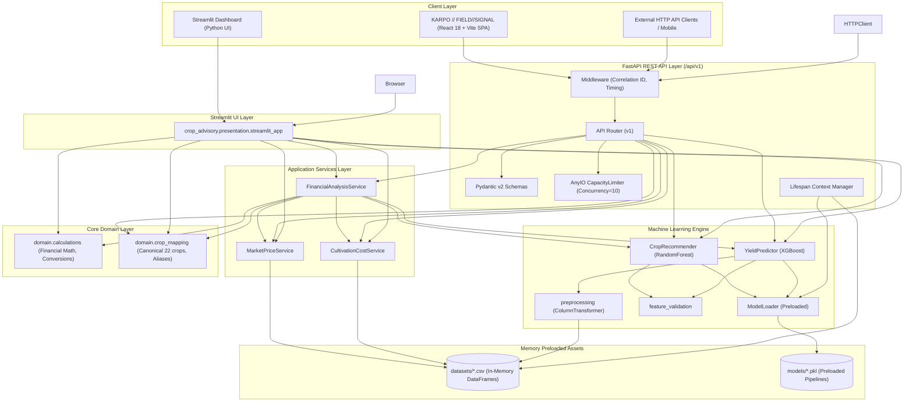

# System Architecture: Smart Crop Advisory System

## 1. Overview & Architectural Principles

The **Smart Crop Advisory System** is an enterprise-grade agricultural intelligence platform bridging agronomy, predictive meteorology, econometric modeling, and machine learning.

The codebase adheres to strict clean architecture principles:
1. **Decoupled Core Domain**: Pure business logic (financial formulas, unit conversions, canonical crop taxonomies) has zero external framework dependencies.
2. **Independent Machine Learning Engine**: Model inference, preprocessing transformers, and feature validators are decoupled from user interfaces and HTTP servers.
3. **Dedicated Service Layer**: Encapsulates external datasets (CACP C2 surveys, Agmarknet Mandi prices) and coordinates multi-step workflows.
4. **Asynchronous REST API (FastAPI)**: Production-grade asynchronous REST API exposing all intelligence capabilities through versioned endpoints (`/api/v1`) with Pydantic v2 validation.
5. **Interactive UI (Streamlit)**: Dashboard interface reusing identical service and domain layers.
6. **Deterministic Packaging**: Powered by `uv` and standard `pyproject.toml` (PEP 621) with reproducible lockfiles (`uv.lock`).

---

## 2. Directory Hierarchy

```
smart-crop-advisory-ml/
├── pyproject.toml              # PEP 621 build and dependency specification
├── uv.lock                     # Deterministic, platform-consistent dependency lockfile
├── README.md                   # Project documentation, quickstart, and reference
├── Dockerfile                  # Multi-stage production container build
├── .dockerignore               # Container build context filter
├── .python-version             # Python version pin (3.12)
├── .env.example                # Template environment variables
│
├── src/
│   ├── crop_advisory/          # Primary package root
│   │   ├── __init__.py         # Package entry and version metadata
│   │   ├── config.py           # Centralized path resolution, constants, and feature bounds
│   │   ├── exceptions.py       # Domain-specific exception hierarchy
│   │   │
│   │   ├── api/                # Production Asynchronous REST API (FastAPI)
│   │   │   ├── __init__.py
│   │   │   ├── config.py       # APISettings via pydantic-settings
│   │   │   ├── lifespan.py     # Startup/shutdown model preloading & resource cleanup
│   │   │   ├── middleware.py   # Request ID correlation and timing middleware
│   │   │   ├── errors.py       # Centralized exception handlers and ErrorResponse
│   │   │   ├── dependencies.py # Dependency injection singletons and readiness guards
│   │   │   ├── main.py         # FastAPI application factory (create_app)
│   │   │   └── v1/             # Version 1 API
│   │   │       ├── router.py   # Versioned route aggregator
│   │   │       ├── schemas.py  # Pydantic v2 request/response schemas with field bounds
│   │   │       └── endpoints/  # Resource-oriented route handlers
│   │   │           ├── health.py            # Liveness and readiness probes
│   │   │           ├── crops.py             # Crop recommendation & taxonomy
│   │   │           ├── yield_prediction.py  # Yield prediction & benchmarks
│   │   │           ├── market.py            # Mandi prices & APMC search
│   │   │           ├── cultivation_costs.py # CACP cost of cultivation
│   │   │           ├── financial_analysis.py# Farm profitability & ROI
│   │   │           └── advisory.py          # Unified full advisory pipeline
│   │   │
│   │   ├── domain/             # Pure domain logic and data structures
│   │   │   ├── schemas.py      # Typed dataclasses for inputs, outputs, and KPIs
│   │   │   ├── calculations.py # Financial math, unit conversions (ha/acre/q/kg), INR formatting
│   │   │   └── crop_mapping.py # Canonical 22-crop metadata, aliases, cross-dataset keys
│   │   │
│   │   ├── ml/                 # Machine learning models and preprocessing pipelines
│   │   │   ├── model_loader.py # Thread-safe, cached joblib artifact loader
│   │   │   ├── feature_validation.py # Agronomic bounds checking and strict schema validation
│   │   │   ├── preprocessing.py# Scikit-learn ColumnTransformers, Scalers, Encoders
│   │   │   ├── crop_recommender.py # Random Forest/XGBoost multi-class classifier
│   │   │   └── yield_predictor.py  # XGBoost/Random Forest continuous yield regressor
│   │   │
│   │   ├── services/           # Data query and workflow orchestration services
│   │   │   ├── market_service.py # APMC Mandi modal price, MSP, and price bounds
│   │   │   ├── cultivation_cost_service.py # CACP comprehensive C2 cultivation cost queries
│   │   │   └── financial_analysis_service.py # End-to-end advisory generation orchestrator
│   │   │
│   │   └── presentation/       # User interface and dashboard presentation
│   │       └── streamlit_app.py # Multi-tab Streamlit dashboard
│   │
│   └── [Backward Compatibility Layer: src/cost_lookup.py, src/crop_mapping.py, etc.]
│
├── models/                     # Trained ML pipelines and artifacts
│   ├── crop_recommendation_model.pkl
│   ├── crop_recommendation_preprocessor.pkl
│   ├── yield_prediction_model.pkl
│   └── yield_prediction_preprocessor.pkl
│
├── datasets/                   # Reference agricultural datasets
│   ├── Crop_recommendation.csv
│   ├── crop_yield_dataset.csv
│   ├── india-crop-prices.csv
│   └── cost-of-cultivation.csv
│
├── tests/                      # Automated test suite (66 tests)
│   ├── conftest.py             # Shared pytest fixtures
│   ├── unit/                   # Deterministic unit tests
│   ├── integration/            # Multi-component and inference integration tests
│   └── api/                    # Asynchronous REST API and concurrency tests
│       ├── conftest.py
│       ├── test_api_v1.py
│       └── test_concurrency.py
│
└── docs/                       # Architectural and technical documentation
    ├── architecture.md         # System architecture document
    ├── api.md                  # REST API reference manual
    └── operations.md           # Operational and deployment guide
```

---

## 3. Layered Component Architecture



---

## 4. Asynchronous Execution & CPU-Bound ML Inference

### Challenge
Scikit-learn and XGBoost inference are CPU-bound C-extension operations. Calling them directly inside an `async def` endpoint would freeze the Python asyncio event loop, preventing other requests or health probes from progressing.

### Solution
FastAPI route handlers use `anyio.to_thread.run_sync` wrapped in an `anyio.CapacityLimiter`:

```python
async with limiter:
    raw_result = await anyio.to_thread.run_sync(
        recommender.predict,
        payload.n,
        payload.p,
        payload.k,
        payload.temperature,
        payload.humidity,
        payload.ph,
        payload.rainfall,
        payload.top_k,
    )
```

**Guarantees**:
1. The asyncio event loop remains non-blocking for I/O and health checks.
2. The number of simultaneous CPU worker threads is strictly capped (default: 10) to prevent OS thread thrashing and memory exhaustion.
3. No per-request model loading: all pipelines and CSV datasets are preloaded during lifespan initialization.

---

## 5. Persistence Decision: Stateless Architecture

**Decision**: The application is intentionally designed as a **stateless REST API** with no persistent database (PostgreSQL/SQLAlchemy).

**Rationale**:
1. All domain calculations (crop classification, yield forecasting, mandi price lookup, cultivation cost estimation, farm financials) are pure mathematical or tabular lookups.
2. The system does not maintain durable farmer accounts, authentication credentials, farm profiles, or historical prediction records in Phase 2.
3. Statelessness enables trivial horizontal scaling across container instances with zero database migration overhead, connection pooling bottlenecks, or split-brain state issues.

---

## 6. Technology Stack

| Component | Choice | Rationale |
|:---|:---|:---|
| **Package & Env Manager** | `uv` (0.11.x) | Ultra-fast dependency resolution and lockfile maintenance |
| **HTTP Framework** | `FastAPI` (0.110+) | High-performance ASGI framework with automatic OpenAPI docs |
| **Validation Engine** | `Pydantic v2` | Native C-speed validation and schema serialization |
| **Configuration** | `pydantic-settings` | Typed environment variable parsing with validation |
| **ASGI Server** | `Uvicorn` | Standard ASGI server with uvloop and httptools |
| **Async Concurrency** | `AnyIO` | Structured async/thread bridges with CapacityLimiter |
| **HTTP Client** | `HTTPX` | Connection-pooled asynchronous HTTP client |
| **ML Engine** | `scikit-learn`, `xgboost`, `joblib` | Production-tested classification and gradient boosted regression |
| **Data Processing** | `pandas`, `numpy` | High-efficiency vectorized operations |
| **Test Suite** | `pytest`, `pytest-asyncio` | Automated unit, integration, API, and concurrency tests (66 tests) |
| **Code Quality** | `ruff`, `mypy` | Strict static linting, formatting, and type checks |
